```{=openxml}
<w:p><w:r><w:br w:type="page"/></w:r></w:p>
```

# Abstract

Two electric-vehicle (EV) charging stations that share a market must each choose a price per kWh without knowing the other's choice. A higher price earns a larger margin on each kWh, but customers move to the cheaper station. We model this interaction as a two-player, simultaneous, non-cooperative game with two pure strategies per player (Low = ₹10/kWh, High = ₹12/kWh). Payoffs are derived from a demand-allocation rule and a profit equation, and the payoff matrix, best responses and Nash equilibria are computed by a Python module rather than entered by hand. Under the baseline assumptions (1,000 kWh of demand, ₹6/kWh variable cost, 80% of demand to the cheaper station), Low is a strictly dominant strategy for both stations, so (Low, Low) is the unique pure-strategy Nash equilibrium with a profit of ₹2,000 each. The outcome (High, High) would yield ₹3,000 each and the highest combined profit (₹6,000), but it is not stable, because each station gains ₹200 by undercutting. The game satisfies the Prisoner's Dilemma ordering T > R > P > S. A sensitivity analysis that re-solves the game for every parameter value shows that the result depends on how strongly price moves customers: below q = 2/3 the equilibrium becomes (High, High), and between 2/3 and 3/4 both outcomes are equilibria. The model is delivered as an interactive Streamlit website with 48 automated tests. All prices and costs are illustrative assumptions, not market data.

# 1. Introduction

Public EV charging is a growing service in which nearby stations compete for the same drivers. Price is the most visible lever an operator controls. Whether a station should cut its price depends on how its competitor prices, which is the kind of interdependent decision that game theory studies. In ordinary optimisation a firm treats its environment as fixed; in a game each player's best action depends on the actions of others, and the analysis looks for outcomes that are stable once everyone's incentives are taken into account.

This project builds a small, transparent model of that situation, computes its equilibria algorithmically, and makes the results explorable through an interactive website. The aim is to demonstrate the *application* of core game-theory tools (payoff matrices, best responses, dominant strategies, Nash equilibrium, the Prisoner's Dilemma and mixed strategies) to a concrete pricing problem.

# 2. Problem Statement

Two EV charging stations operating in the same market must choose their charging prices while competing for customers. Charging a higher price increases profit per unit of electricity sold, but customers may prefer a cheaper competing station. Charging a lower price attracts more customers but reduces the profit earned per unit. Each station's profit therefore depends on both stations' prices and on the resulting split of customer demand.

The project models this strategic interaction using non-cooperative game theory and investigates, with payoff matrices, best-response analysis, Nash equilibrium and joint-profit comparison, which prices the stations will choose and why.

# 3. Objectives

1. Model two competing EV charging stations as players in a game.
2. Define a strategy set and a mathematically justified payoff function.
3. Construct the payoff matrix programmatically.
4. Calculate each player's best responses.
5. Determine all pure-strategy Nash equilibria algorithmically.
6. Explain why the equilibrium occurs and whether players have an incentive to deviate.
7. Compare individual profit maximisation with joint-profit maximisation.
8. Visualise prices, market shares, revenue, costs and profits.
9. Let users change the assumptions and observe how the strategic outcome changes.
10. Deliver an interactive website, automated tests, this report and a presentation.

**Research question.** When two charging stations compete on price, which prices will they choose, and how does that compare with the prices that maximise their combined profit?

# 4. Scope of the Project

The core model is a one-shot, two-player game with two price levels. It includes a demand-allocation rule, a constant per-kWh operating cost and complete information. It covers pure-strategy equilibria, dominance, joint-profit comparison, a Prisoner's Dilemma test, the mixed-strategy equilibrium of the 2×2 game, and a sensitivity analysis over the market-share parameter and a second parameter (operating cost or high price).

Out of scope: continuous pricing, elastic total demand, capacity and queues, location, entry decisions, repeated interaction and calibration to real tariffs. The numbers are illustrative values for an academic simulation and are not presented as verified market prices.

# 5. Background: Game-Theory Concepts

**Normal-form game.** A game is described by its players, each player's set of strategies, and a payoff for every combination of strategies. For two players with finitely many strategies, the payoffs can be written as a matrix whose cells list (payoff of row player, payoff of column player).

**Best response.** A strategy is a best response to an opponent's strategy if no other strategy gives the player a higher payoff against it. A player may have several best responses when payoffs tie.

**Dominant strategy.** A strategy is *strictly dominant* if it gives a strictly higher payoff than every alternative, whatever the opponent does. It is *weakly dominant* if it is never worse and sometimes strictly better.

**Nash equilibrium.** A strategy profile is a Nash equilibrium if every player's strategy is a best response to the others' strategies, so that no player can gain by changing strategy unilaterally (Nash, 1950; 1951).

**Joint-profit maximisation.** The strategy profile that maximises the sum of the players' payoffs. It describes what the players would choose if they could act as one; it need not be an equilibrium.

**Prisoner's Dilemma.** A symmetric 2×2 game in which, with "cooperate" and "defect" strategies, the payoffs satisfy *Temptation > Reward > Punishment > Sucker*. Defecting is then dominant, yet mutual cooperation gives both players more than mutual defection (Axelrod, 1984).

**Mixed strategy.** A probability distribution over pure strategies. In a 2×2 game an interior (fully mixed) equilibrium makes each player indifferent between its two pure strategies.

**Price competition.** Classical models of price competition include Bertrand (1883), in which firms selling identical goods undercut each other, and Hotelling (1929), in which location softens competition. Our model is a simplified discrete version: the cheaper station gains a fixed share of customers rather than the whole market.

# 6. Mathematical Formulation

## 6.1 Players, strategies and payoffs

- **Players:** Station A and Station B.
- **Strategies:** each station chooses Low ($p_L$ = ₹10/kWh) or High ($p_H$ = ₹12/kWh).
- **Timing:** simultaneous; neither station observes the other's choice.
- **Payoffs:** each station's profit in rupees.
- **Information:** complete; both stations know the model and its payoffs.
- **Type:** non-cooperative, finite, two-player, normal-form game.

## 6.2 Model assumptions

| Parameter | Symbol | Baseline value |
|---|---|---:|
| Total market demand | $D$ | 1,000 kWh |
| Low price | $p_L$ | ₹10/kWh |
| High price | $p_H$ | ₹12/kWh |
| Station A variable operating cost | $c_A$ | ₹6/kWh |
| Station B variable operating cost | $c_B$ | ₹6/kWh |
| Share captured by the cheaper station | $q$ | 0.80 |
| Share of each station at equal prices | — | 0.50 |

Simplifications, stated explicitly:

- Both stations serve one shared market, and total demand $D$ is fixed.
- Demand allocation depends only on which price is lower, not on the absolute prices or the size of the gap.
- When prices are equal the market is divided equally.
- There are no fixed costs, capacity constraints, queues or entry decisions.
- Marginal operating cost is constant.
- Both stations have complete knowledge of the model and payoffs.

These are simplifying assumptions, not claims about how every real EV charging market behaves.

## 6.3 Demand allocation and profit equations

Let $s_A$ be the share of demand served by Station A:

$$
s_A =
\begin{cases}
0.5 & \text{if } p_A = p_B \\
q & \text{if } p_A < p_B \\
1 - q & \text{if } p_A > p_B
\end{cases}
\qquad s_B = 1 - s_A
$$

Energy sold, revenue, variable cost and profit are:

$$E_A = D\,s_A, \qquad E_B = D\,(1 - s_A)$$

$$R_i = p_i E_i, \qquad C_i = c_i E_i, \qquad \pi_i = (p_i - c_i)\,E_i \quad (i = A, B)$$

Because the shares always sum to one, $E_A + E_B = D$ in every outcome.

## 6.4 Baseline payoff matrix

Each cell shows (Profit A, Profit B). The values below are produced by the code (`game_theory.payoff_matrix`), not typed in.

| Station A \\ Station B | Low (₹10) | High (₹12) |
|---|---:|---:|
| **Low (₹10)** | (₹2,000, ₹2,000) | (₹3,200, ₹1,200) |
| **High (₹12)** | (₹1,200, ₹3,200) | (₹3,000, ₹3,000) |

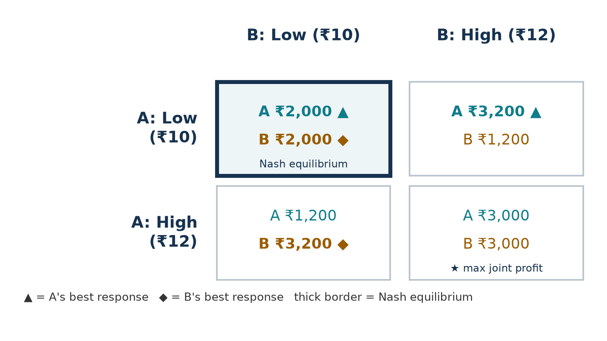{width=85%}

**Verification of two cells.** If A plays Low and B plays High, A is cheaper and serves 80% of 1,000 kWh = 800 kWh, earning (10 − 6) × 800 = ₹3,200; B serves 200 kWh and earns (12 − 6) × 200 = ₹1,200. If both play High they serve 500 kWh each and earn (12 − 6) × 500 = ₹3,000 each.

## 6.5 Best-response analysis

| If the rival plays | A's profit from Low | A's profit from High | A's best response |
|---|---:|---:|---|
| Low | ₹2,000 | ₹1,200 | Low |
| High | ₹3,200 | ₹3,000 | Low |

The game is symmetric, so Station B's best responses are identical: Low against Low and Low against High.

## 6.6 Nash equilibrium derivation

Low is the best response to *both* rival strategies, so Low is a **strictly dominant strategy** for each station:

- If the rival chooses Low, Low yields ₹2,000 versus ₹1,200 from High.
- If the rival chooses High, Low yields ₹3,200 versus ₹3,000 from High.

The algorithm enumerates all four profiles and marks a profile as an equilibrium only when both players are best-responding. Only **(Low, Low)** passes, so it is the **unique pure-strategy Nash equilibrium**, with ₹2,000 for each station. A unilateral switch from (Low, Low) to High would reduce the deviator's profit from ₹2,000 to ₹1,200.

Every other profile has a profitable unilateral deviation:

| Profile | Profitable deviation |
|---|---|
| (Low, High) | B switches to Low and gains ₹800 |
| (High, Low) | A switches to Low and gains ₹800 |
| (High, High) | Either station switches to Low and gains ₹200 |

**Mixed strategies.** Writing A's payoffs in row-major order as $a, b, c, d$ = 2000, 3200, 1200, 3000, the probability with which B must play Low to make A indifferent is

$$q^* = \frac{d - b}{a - b - c + d} = \frac{3000 - 3200}{2000 - 3200 - 1200 + 3000} = \frac{-200}{600} = -\tfrac{1}{3}.$$

A probability cannot be negative, so the baseline game has **no interior mixed-strategy equilibrium**; this is consistent with Low being strictly dominant. (When q = 0.70 the indifference conditions do give a valid interior equilibrium; see Section 12.)

## 6.7 Joint-profit and Prisoner's Dilemma analysis

| Outcome | Station A | Station B | Combined profit |
|---|---:|---:|---:|
| Low / Low (Nash equilibrium) | ₹2,000 | ₹2,000 | ₹4,000 |
| Low / High | ₹3,200 | ₹1,200 | ₹4,400 |
| High / Low | ₹1,200 | ₹3,200 | ₹4,400 |
| High / High (joint maximum) | ₹3,000 | ₹3,000 | ₹6,000 |

High/High maximises combined profit, while Low/Low is the equilibrium; the stations together forgo ₹2,000 by following individual incentives. This is a statement about the firms' combined profit only: drivers pay less in the Low/Low outcome, so the joint-profit maximum is not automatically the socially preferable one.

Treating High as "cooperate" and Low as "defect", each station's payoffs are:

| Payoff | Meaning | Value |
|---|---|---:|
| Temptation T | undercut a rival who charges High | ₹3,200 |
| Reward R | both charge High | ₹3,000 |
| Punishment P | both charge Low | ₹2,000 |
| Sucker S | charge High while the rival undercuts | ₹1,200 |

Since 3,200 > 3,000 > 2,000 > 1,200, the ordering **T > R > P > S holds for both players**, and the baseline game is a Prisoner's Dilemma. The code also checks 2R > T + S (6,000 > 4,400), the usual extra condition that mutual cooperation beats alternating exploitation. The classification is computed, not assumed: it is re-evaluated whenever the parameters change and disappears when the inequalities fail.

**General thresholds.** With equal costs $c$, Low is the better reply to a Low rival when $(p_L - c)\cdot 0.5 > (p_H - c)(1 - q)$, i.e. $q > 1 - \dfrac{p_L - c}{2(p_H - c)}$, and the better reply to a High rival when $(p_L - c)\,q > (p_H - c)\cdot 0.5$, i.e. $q > \dfrac{p_H - c}{2(p_L - c)}$. At the baseline these are $q > 2/3$ and $q > 3/4$; the baseline $q = 0.8$ exceeds both, which is why Low is dominant.

# 7. Software Architecture

The project is a small Python application with one source of truth for all calculations.

| File | Responsibility |
|---|---|
| `game_theory.py` | Parameters and validation, demand shares, revenue/cost/profit, payoff matrix, best responses, Nash search, deviations, dominance, joint profit, Prisoner's Dilemma test, mixed equilibrium, sensitivity analysis. No user-interface code. |
| `visualizations.py` | Plotly charts built from `game_theory` results. |
| `app.py` | Streamlit website: eight pages, navigation, session state, styling. Contains no profit arithmetic. |
| `team.py` | Project title and team details shared by the app and the slides. |
| `make_docs.py` | Generates report figures (Matplotlib) and `presentation.pptx` (python-pptx) from the model. |
| `tests/` | Pytest suites for the model and parameter validation. |

The equilibrium functions accept any two-player payoff matrix, not just the pricing game. This lets the tests check them on textbook games (coordination, chicken, matching pennies) whose answers are known independently.

# 8. Implementation Methodology

1. **Model first.** The demand rule and profit equation were implemented in `game_theory.py` and checked by hand against the four baseline payoffs before any interface work.
2. **Generic solver.** `best_responses_a/b` return *every* maximising strategy (ties within ₹0.000001 are kept). `pure_nash_equilibria` returns every profile where both players are best-responding, so the solver handles unique, multiple and non-existent pure equilibria.
3. **Diagnostics.** `unilateral_deviations` lists the payoff change for each single-player switch; the website uses it to explain why a cell is or is not an equilibrium.
4. **Dominance and PD.** `dominant_strategy` distinguishes strict and weak dominance; `prisoners_dilemma` extracts T, R, P, S for each player from the matrix and tests the inequalities.
5. **Mixed strategies.** `mixed_equilibrium_2x2` applies the indifference formulas, checks for zero denominators and accepts the result only if both probabilities lie strictly between 0 and 1.
6. **Sensitivity.** `sensitivity_q` and `sensitivity_grid` rebuild the parameters, recompute the matrix and re-run the solver at every grid point.
7. **Validation.** `validation_errors` returns readable messages for invalid inputs (non-positive prices, high ≤ low, non-positive demand, negative cost, cost ≥ low price, q outside [0.5, 1], non-finite values); `analyze` raises a `ValueError` rather than returning wrong numbers.

# 9. User Interface Design

The website (`streamlit run app.py`) uses a dark, low-glare theme: an off-black background, off-white text and a single muted teal accent. Station A is shown in teal and Station B in amber with a hatch pattern, so the two remain distinguishable without colour. Its eight pages follow the logic of the analysis:

1. **Executive overview:** problem, research question, objectives, a flow diagram of the game, the core equations, parameter table and key findings, all computed for the current parameters.
2. **Configure the market:** inputs for both prices, demand, both costs and q, with validation messages and a restore-baseline button.
3. **Payoff matrix:** the 2×2 matrix with best responses (▲ for A, ◆ for B, bold and underlined), the Nash cell (thick border and label), the joint maximum (★) and the selected cell (dashed outline), plus a legend and a projector mode with large text.
4. **Strategy simulator:** choose each station's price and see price, share, energy, revenue, cost and profit, followed by side-by-side tables of what happens if A or B switches alone.
5. **Nash equilibrium lab:** why each equilibrium qualifies, best responses and dominance, profitable deviations from non-equilibria, joint-profit comparison, the Prisoner's Dilemma check and the mixed-strategy analysis.
6. **Charts and sensitivity:** profit comparison, joint profit, demand split, the q-sensitivity chart and the two-parameter equilibrium map.
7. **Applications and limitations.**
8. **Methodology and viva guide:** concept summaries and eleven likely viva questions with answers that match the implementation.

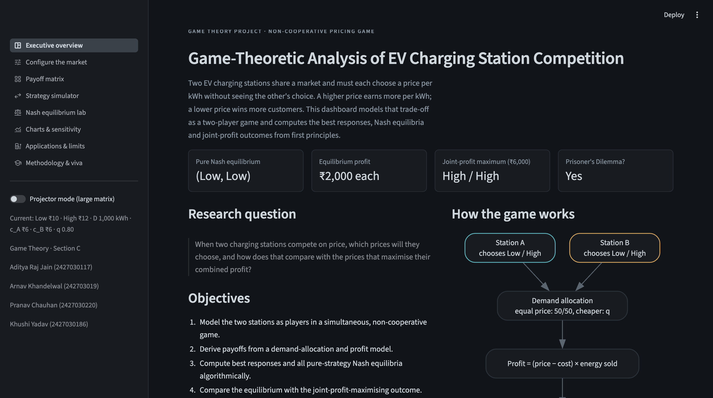{width=100%}

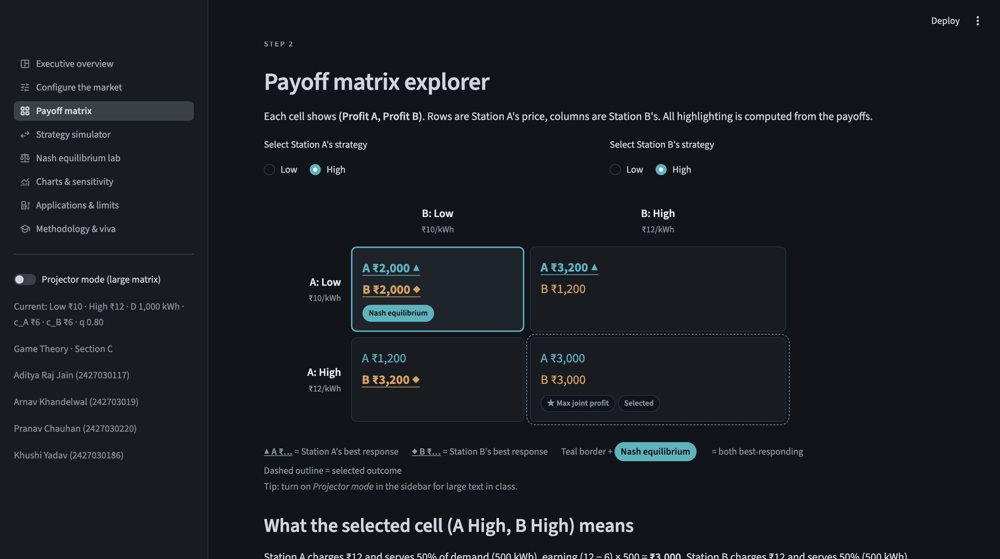{width=100%}

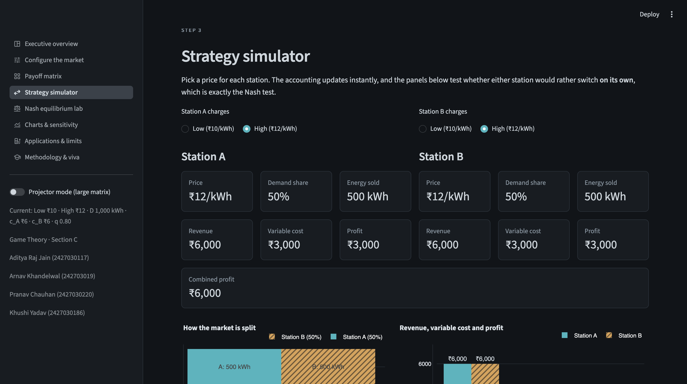{width=100%}

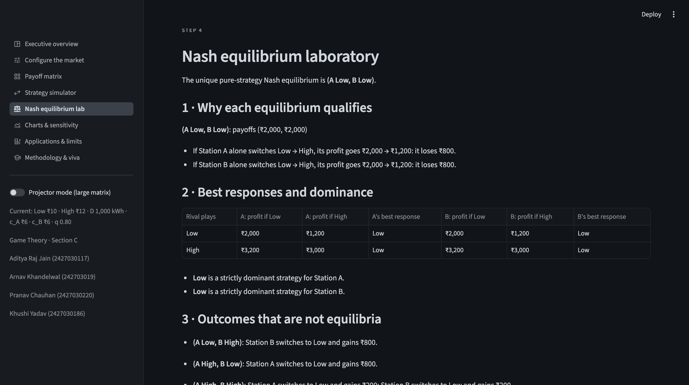{width=100%}

# 10. Testing Methodology and Results

Automated tests were written with pytest and cover:

- **Baseline payoffs:** all four cells, plus energy, revenue and cost for Low/High.
- **Demand allocation:** equal split at equal prices; q and 1 − q for the cheaper and dearer station; shares summing to 1 and energy summing to total demand for five values of q.
- **Profit accounting:** revenue, cost and profit identities with non-baseline numbers; asymmetric costs; profit scaling with demand.
- **Best responses and equilibria:** baseline best responses and unique equilibrium; the profitable deviations from High/High; two equilibria at q = 0.70; (High, High) at q = 0.60; ties kept at q = 0.75; textbook coordination, anti-coordination (chicken) and matching-pennies games (no pure equilibrium).
- **Mixed strategies:** the computed mix makes each player indifferent (checked independently with expected payoffs); no interior equilibrium at baseline; a degenerate all-equal game.
- **Joint profit and Prisoner's Dilemma:** joint profits and maximiser; T, R, P, S values and the ordering.
- **Dynamic behaviour:** changing q and costs changes the matrix and analysis; sensitivity results recalculated; analytical thresholds agree with the solver; equilibrium grid codes.
- **Validation:** nine invalid-parameter cases raise clear errors; unknown strategies are rejected; boundary cases q = 0.5 and q = 1.

**Result.** Running `pytest -v` on Python 3.14.6 with pytest 9.1.1 collected **48 tests, and all 48 passed** (0.10 s).

The website was also checked manually in a browser: every page loaded without exceptions; entering a high price below the low price showed the validation message and kept the last valid parameters; *Restore baseline* reset all inputs; and setting the high price to ₹16 produced two equilibria with weak dominance and switched off the Prisoner's Dilemma label, as the formulas predict.

# 11. Sensitivity Analysis

The sensitivity analysis is a *parameter experiment* on the illustrative model, not an empirical prediction. At every grid point the code rebuilds the parameters, recomputes all payoffs and re-runs the equilibrium search.

**Varying q (other parameters at baseline).** Selected rows of the computed results:

| q | (L,L) | (L,H) | (H,L) | (H,H) | Pure Nash equilibria | Prisoner's Dilemma? |
|---:|---|---|---|---|---|---|
| 0.50 | 2000, 2000 | 2000, 3000 | 3000, 2000 | 3000, 3000 | (High, High) | No |
| 0.60 | 2000, 2000 | 2400, 2400 | 2400, 2400 | 3000, 3000 | (High, High) | No |
| 0.70 | 2000, 2000 | 2800, 1800 | 1800, 2800 | 3000, 3000 | (Low, Low) & (High, High) | No |
| 0.75 | 2000, 2000 | 3000, 1500 | 1500, 3000 | 3000, 3000 | (Low, Low) & (High, High) | No |
| 0.80 | 2000, 2000 | 3200, 1200 | 1200, 3200 | 3000, 3000 | (Low, Low) | Yes |
| 0.90 | 2000, 2000 | 3600, 600 | 600, 3600 | 3000, 3000 | (Low, Low) | Yes |
| 1.00 | 2000, 2000 | 4000, 0 | 0, 4000 | 3000, 3000 | (Low, Low) | Yes |

Three regimes appear, matching the thresholds of Section 6.7:

- **q < 2/3:** undercutting wins too few customers; High is strictly dominant and (High, High) is the unique equilibrium.
- **2/3 < q < 3/4:** each station prefers to match the rival's price, so the game is a coordination game with two pure equilibria and an interior mixed equilibrium (at q = 0.70, each station plays Low with probability 0.5 and expects ₹2,400). At exactly q = 3/4 Low is only weakly dominant and both pure equilibria remain, because of a tie the solver keeps.
- **q > 3/4:** Low is strictly dominant, (Low, Low) is the unique equilibrium and the game is a Prisoner's Dilemma.

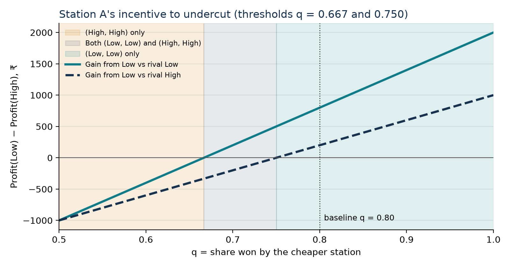{width=95%}

**Second parameter: operating cost.** With both stations' cost $c$ varied from ₹0 to ₹9.90, the thresholds move: at $c$ = 0 they are q = 0.583 and 0.600; at $c$ = 4 they are 0.625 and 0.667; at $c$ = 8 they are 0.750 and 1.000. Higher costs shrink the low price's margin relative to the high price's, so a larger share advantage is needed before undercutting pays. The website offers the same map with the high price as the second parameter.

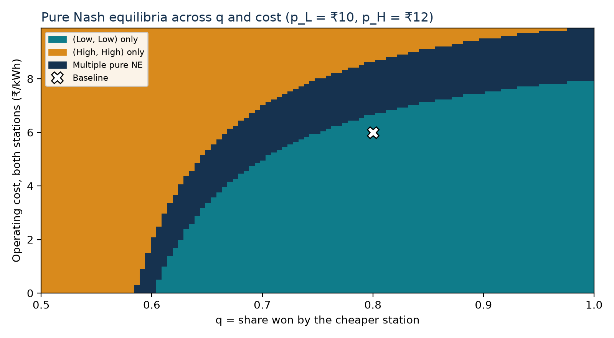{width=95%}

**Asymmetric costs.** With $c_A$ = ₹4 and $c_B$ = ₹8, the payoffs become (3,000, 1,000), (4,800, 800), (1,600, 1,600) and (4,000, 2,000) for LL, LH, HL and HH; the unique equilibrium is still (Low, Low), but the low-cost station earns three times as much as its rival there.

# 12. Results and Discussion

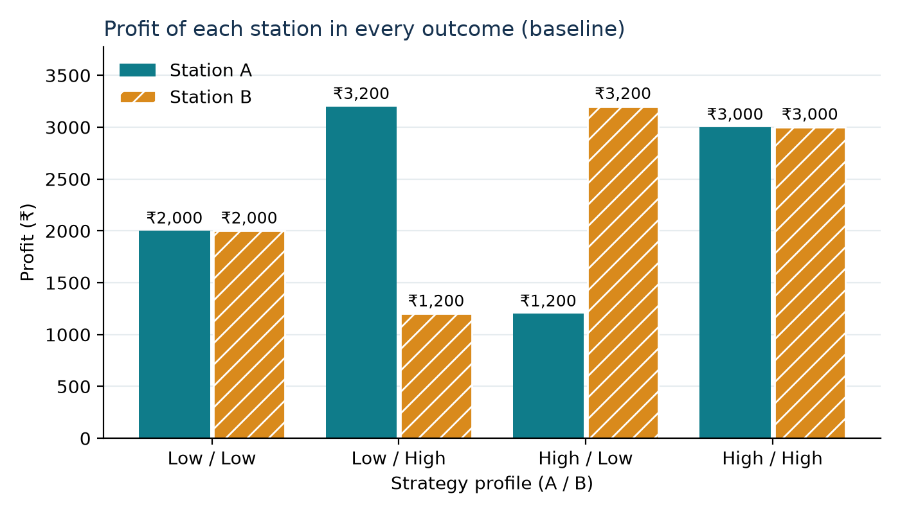{width=80%}

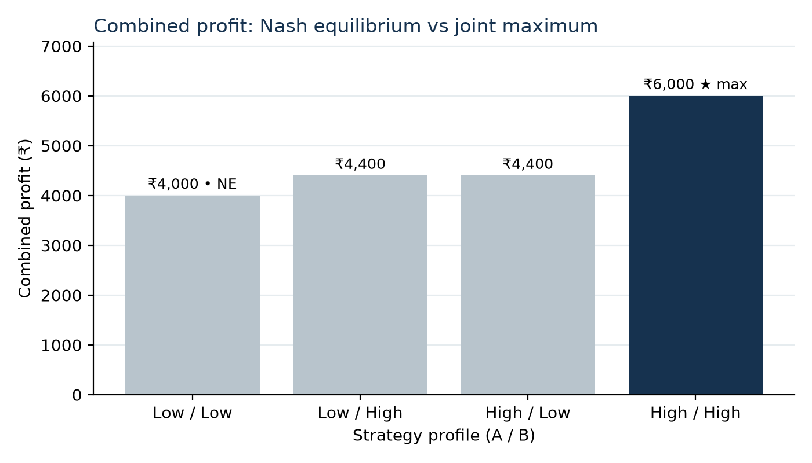{width=80%}

1. **Equilibrium.** Under the baseline assumptions, both stations charge the low price. The reasoning does not require either station to predict the other: Low is better whatever the rival does.
2. **Inefficiency for the firms.** The equilibrium gives ₹4,000 combined, against ₹6,000 at (High, High). The stations would both prefer (High, High), but neither can trust the other to stay there, since undercutting earns ₹200 more. This is the classic Prisoner's Dilemma structure behind price wars.
3. **Role of price sensitivity.** The result depends on q. Undercutting is attractive only when it wins enough extra customers to compensate for the thinner margin. When drivers are less price-sensitive (q < 2/3), High becomes dominant and the stations settle at the high price without any agreement.
4. **Multiple equilibria.** In the intermediate range both (Low, Low) and (High, High) are stable. Which one occurs then depends on expectations or history, something the one-shot model cannot decide.
5. **Consumers.** The low-price equilibrium is worse for the firms but better for drivers; the model compares firm profits only and does not measure consumer welfare.

The website's screenshots below show how these results are presented interactively.

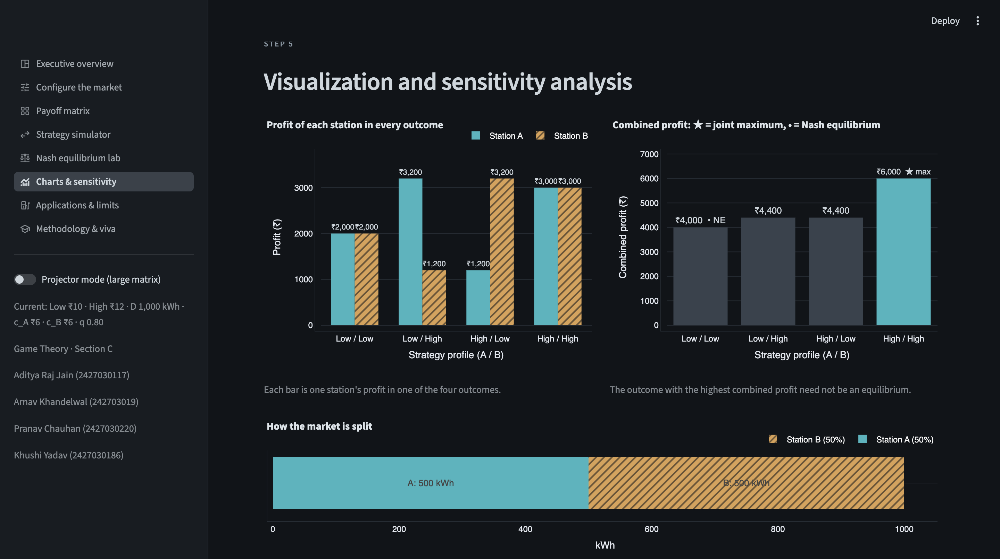{width=100%}

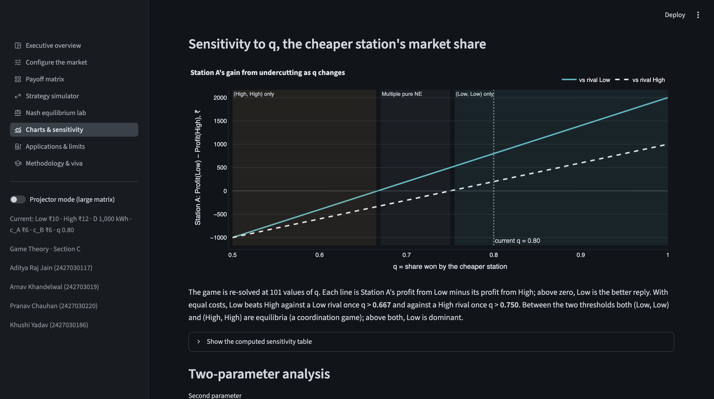{width=100%}

# 13. Applications

- **EV charging network operators:** reasoning about how a nearby competitor will respond before changing prices.
- **Charging-price competition:** explaining why price cuts can spread even when they lower both operators' profits.
- **Strategic decisions by competing businesses:** the same structure applies to any duopoly where customers move to the cheaper option.
- **Market-share trade-offs:** q summarises customer price sensitivity; the sensitivity analysis shows how much sensitivity is needed for undercutting to pay.
- **Individual versus combined profit:** the gap between the equilibrium and the joint maximum is the tension behind discussions of tacit collusion and regulation.

# 14. Limitations

- Fixed total market demand: lower prices do not attract additional drivers.
- The 80/20 split is a simplified assumption, not an estimated demand function, and ignores the size of the price gap.
- Only two pricing actions in the core model.
- No charging capacity, waiting queues, location or network effects.
- No fixed costs or investment decisions.
- No real-world price calibration; prices and costs are illustrative.
- No empirical dataset and no claim of empirical validation. The model explains incentives; it does not predict actual market prices.

# 15. Future Scope

- Continuous prices with price-sensitive demand (Bertrand-style competition).
- Station capacity, queues and waiting-time costs.
- Location-based competition (Hotelling) and asymmetric customer preferences.
- Repeated interaction, in which the threat of future price wars may sustain (High, High).
- More than two stations, entry decisions and regulatory price caps.
- Calibration with real tariff and demand data.

# 16. Conclusion

The project modelled price competition between two EV charging stations as a two-player, simultaneous, non-cooperative game and computed its solution with a tested Python module. Under the baseline assumptions, Low is strictly dominant for both stations, (Low, Low) is the unique pure-strategy Nash equilibrium with ₹2,000 each, and the game is a Prisoner's Dilemma: (High, High) would give both stations more (₹3,000 each) but is not stable. The sensitivity analysis shows that this conclusion depends on customer price sensitivity and margins, with a regime of two equilibria and a regime where High is dominant. The interactive website, report and presentation all draw their numbers from the same model, so the analysis can be explored, verified and extended.

# References

1. Nash, J. F. (1950). Equilibrium points in n-person games. *Proceedings of the National Academy of Sciences*, 36(1), 48–49.
2. Nash, J. F. (1951). Non-cooperative games. *Annals of Mathematics*, 54(2), 286–295.
3. Osborne, M. J. (2004). *An Introduction to Game Theory*. Oxford University Press.
4. Axelrod, R. (1984). *The Evolution of Cooperation*. Basic Books.
5. Hotelling, H. (1929). Stability in competition. *The Economic Journal*, 39(153), 41–57.
6. Bertrand, J. (1883). Review of *Théorie mathématique de la richesse sociale* and *Recherches sur les principes mathématiques de la théorie des richesses*. *Journal des Savants*, 67, 499–508.
7. Harris, C. R., et al. (2020). Array programming with NumPy. *Nature*, 585, 357–362.
8. Streamlit documentation. https://docs.streamlit.io
9. Plotly Python documentation. https://plotly.com/python/
10. pytest documentation. https://docs.pytest.org
